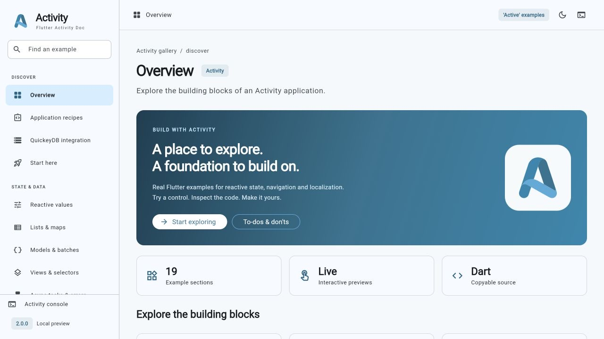
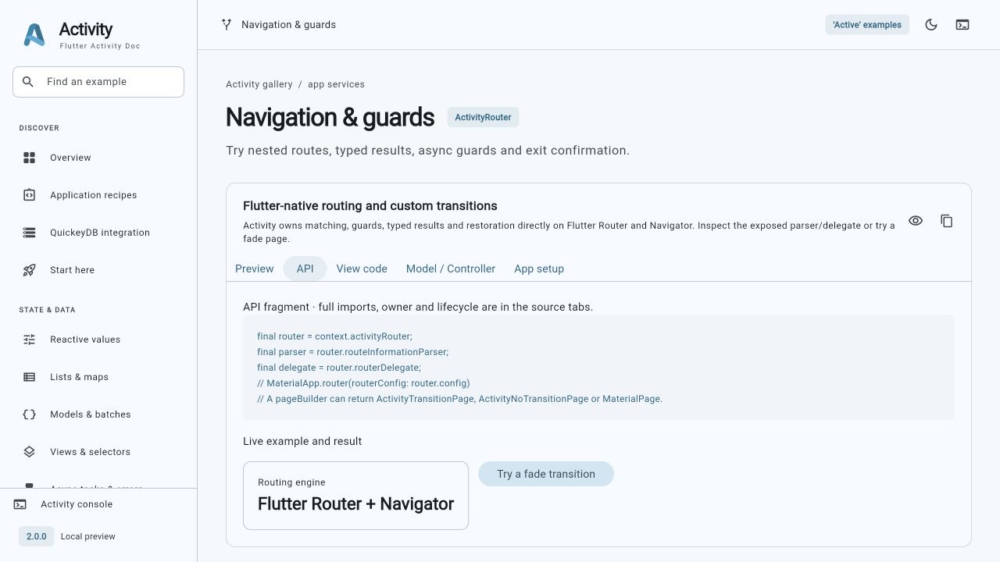

# Activity Gallery

**Explore Activity through 19 interactive Material sections.**

[Package guide](../README.md) · [Test map](../test/README.md) · [Implementation status](../Observations.md)

The gallery takes its navigation and preview/source organization from the
[Fluent UI Flutter showcase](https://bdlukaa.github.io/fluent_ui/), with Material
components, typography, colors and interaction patterns throughout. No Fluent UI
dependency is required.



[See code beside live results](#live-results) · [API example index](../doc/API_SNIPPETS.md)

[Phone screenshot](gallery-mobile.jpg) · [API coverage checklist](../doc/GALLERY_COVERAGE.md) · [Integration and migration](../doc/GALLERY_MIGRATION.md)

## Standalone package example

[activity_example.dart](activity_example.dart) is the self-contained pub.dev
counter example, also displayed in [example.md](example.md) for the Example tab. Copy it to your application's lib/main.dart and depend on the
released Activity 2.0.0 (or this checkout before publication). It needs no
QuickeyDB, gallery assets or companion repository.

The full gallery below is a workspace app with an optional QuickeyDB recipe;
keep the sibling QuickeyDB checkout when running it. Its workspace-only pubspec is
excluded from the pub.dev upload so package dependency resolution works without
that companion checkout. Clone the repositories to run the gallery.

## Run it

From this directory:

```sh
flutter pub get
flutter run -d chrome
```

Or use `flutter run` with an available native target. Use the searchable sidebar
on desktop and the navigation drawer on narrow screens. Each preview has API, View code, Model / Controller and App setup tabs with
copy controls. Source tabs load the actual compiled files. The bottom-docked
Activity console records metadata only when explicitly enabled in debug builds. Appearance includes light/dark/system themes and five accent colors.

## Explore the examples

| Section | Try it |
| --- | --- |
| Overview | Feature cards and direct links into the gallery |
| Application recipes | Validate/preserve drafts; derive search/filter/sort; paginate async pages; fail, cancel and retry with stale-result protection |
| QuickeyDB integration | Initialize real SQLite, save/refresh/update/delete, abort duplicate titles, demonstrate rollback, return typed record detail results |
| Start here | Follow five setup steps and try a real ActiveView counter |
| Reactive values | Increment/reset integers, clamp a slider, toggle booleans, initialize/clear nullable values, transform text |
| Lists & maps | Add, complete, delete, filter, sort, group and paginate tasks; update map entries and inspect snapshots |
| Models & batches | Replace immutable models with copyWith; update multiple typed values together |
| Views & selectors | Compare independent build counts and try ActiveView / ActiveState |
| Async tasks & errors | Run overlapping tasks, reuse a busy key, simulate failure and inspect handled errors |
| Events & replay | Emit live/sticky messages, attach a late subscriber, await the next event, clear replay, close/restart a local bus |
| Navigation & guards | Open nested named routes with parameters/query values, return typed results, switch independent histories, sign in/out through an async guard, confirm leaving an unsaved editor |
| State restoration | Increment a RestorableInt and edit a RestorableTextEditingController draft; inspect restoration setup |
| Localization & ICU | Switch English, Kiswahili, French and Arabic; explore cardinal plurals, exact selectors, offsets, nested select/plural, fallback keys and an editable ICU pattern |
| Schema validation | Validate email, integer ranges, URLs and a custom username rule; inspect invalid input |
| Environment config | Parse/edit public ENV text, expand variables, inspect typed values, load a bundled asset |
| Strings, dates & IDs | Transform string cases, generate UUIDs, inspect date helpers and emit logger messages |
| Lifecycle & ownership | Mount/unmount a consumer, reset/dispose, register late values and dispose during pending work |
| To-dos & don'ts | Work through a 12-item integration checklist and read practical do/don't pairs |
| Appearance | Change theme, accent and locale using reactive preferences |

## Feature walkthroughs

The API comments link directly to these walkthroughs. Run this checkout with
`flutter run -d chrome`, open the route shown below, and use its **API**, **View
code**, **Model / Controller** and **App setup** tabs. Source and live output stay
together. The comments include complete programs; no published 1.x compatibility
or standalone DartPad package availability is implied.

<a id="start"></a>

### Ownership and setup

Use `/#/start` to create one controller, register its fields and connect its consumers. The owner, not a borrowing child, performs terminal disposal.

[Complete view source](lib/gallery/pages/learning_pages.dart) · [Shared controllers](lib/gallery/controllers.dart)

<a id="values"></a>

### Reactive and nullable values

Use `/#/values` to update numbers, text, flags and dates; populate or clear the optional profile. Nullable constructors use named `value:` arguments. Mutations notify registered owners; `.equals` compares values and `==` compares wrapper identity.

[Complete view source](lib/gallery/pages/state_pages.dart) · [Shared controllers](lib/gallery/controllers.dart)

<a id="collections"></a>

### Collections and derived data

Use `/#/collections` to add/delete tasks, sort/filter/group rows and inspect pages and map snapshots. Snapshots are shallow; use immutable nested models and notifying mutation helpers.

[Complete view source](lib/gallery/pages/state_pages.dart) · [Shared controllers](lib/gallery/controllers.dart)

<a id="models"></a>

### Models and typed batches

Use `/#/models` to replace an immutable profile or commit related `changeTo` assignments through `activate`. Standard assignments are prevalidated; arbitrary setter side effects are not rollback transactions.

[Complete view source](lib/gallery/pages/state_pages.dart) · [Shared controllers](lib/gallery/controllers.dart)

<a id="views"></a>

### Views, scopes and selectors

Use `/#/views` to compare whole-view and selected-value rebuilds. Select immutable values and retain one shared owner; consumers release their own subscriptions.

[Complete view source](lib/gallery/pages/state_pages.dart) · [Shared controllers](lib/gallery/controllers.dart)

<a id="async"></a>

### Asynchronous work and recovery

Use `/#/async` for busy-key tracking and `/#/recipes` for pagination, retry, cancellation and stale-response protection. `activeAsync` does not cancel I/O. Preserve a failed draft; check disposal and generation tokens before applying a response.

[Complete view source](lib/gallery/recipes/workbench.dart) · [Shared controllers](lib/gallery/controllers.dart)

<a id="events"></a>

### Events and subscriptions

Use `/#/events` for typed broadcast events, one-shot waits and sticky replay. Subscribe before emitting, keep and cancel subscriptions, and close the bus from its owner. Events remain isolate-local.

[Complete view source](lib/gallery/pages/service_pages.dart) · [Shared controllers](lib/gallery/controllers.dart)

<a id="navigation"></a>

### Routes, guards and browser history

Use `/#/navigation` for named paths/queries, asynchronous guards and typed results; `/#/database` provides a real record-detail flow. Guard checks are navigation UX, not backend authorization. App setup shows the opt-in URL-reflection policy.

[Complete view source](lib/gallery/pages/service_pages.dart) · [Shared controllers](lib/gallery/controllers.dart)

<a id="localization"></a>

### Localization, ICU and fallback

Use `/#/localization` to switch languages, edit ICU patterns and compare plural/select and fallback messages, including Arabic RTL. Use numeric arguments and an `other` branch; skeleton/ordinal formats are unsupported. Add Activity delegates alongside existing Flutter delegates.

[Complete view source](lib/gallery/pages/service_pages.dart) · [Shared controllers](lib/gallery/controllers.dart)

<a id="validation"></a>

### Form validation

Use `/#/validation` to inspect field errors and sanitized output; `/#/recipes` combines validation and draft preservation. Custom callbacks return null on success. Validation does not provide authorization.

[Complete view source](lib/gallery/pages/utility_pages.dart) · [Shared controllers](lib/gallery/controllers.dart)

<a id="environment"></a>

### Public configuration

Use `/#/environment` for parser edits, public asset loading and typed defaults. Parsing and assets work on web; file loading is native-only. Client configuration is not secret storage.

[Complete view source](lib/gallery/pages/utility_pages.dart) · [Shared controllers](lib/gallery/controllers.dart)

<a id="helpers"></a>

### Helpers, identifiers and logging

Use `/#/helpers` for string/date transformations, identifiers and optional logging. UUIDs identify drafts; they are not credentials. Release logging is off by default, and browser loggers omit ANSI colors.

[Complete view source](lib/gallery/pages/utility_pages.dart) · [Shared controllers](lib/gallery/controllers.dart)

## Learn by changing the code

```text
lib/main.dart                    Entry point
lib/gallery/app.dart             Router, restoration, localization and Material shell
lib/gallery/catalog.dart         Searchable section metadata
lib/gallery/controllers.dart     Shared state and immutable models
lib/gallery/console.dart         Opt-in metadata diagnostics and bottom dock
lib/gallery/source_panel.dart    Actual bundled Dart source with copy controls
lib/gallery/result_terminal.dart Structured local result output and timings
lib/gallery/support_links.dart  Fundraiser, community and configurable URL slots
lib/gallery/recipes/             Complete form/async/SQLite/nullable examples
lib/gallery/widgets.dart         Preview/source cards and responsive layout
lib/gallery/pages/state_pages.dart     Values, collections, models, views and async work
lib/gallery/pages/service_pages.dart   Events, routes, guards, restoration and ICU
lib/gallery/pages/utility_pages.dart   Validation, ENV, strings, dates and identifiers
lib/gallery/pages/learning_pages.dart  Setup, lifecycle, checklist and appearance
assets/i18n/                     Four JSON message catalogs
assets/sample.env                Public sample configuration
```

The root owns the shared controllers and router and disposes them together.
Local demos own and clean up their event bus, text controllers and temporary
controllers. Settings rebuild MaterialApp through an ActivitySelector. Other
previews select immutable records or collection snapshots so changes rebuild the
relevant consumer.

Every section is a stateful shell branch. Switching sections preserves its
Navigator history and mounted preview state. Direct hash links such as
`/#/localization` and `/#/navigation/details/42?tab=summary` work on static web
hosting without server route rewrites. Activity's own Router/Navigator implementation
updates browser URLs for go, push and replace. The sign-in example is a local
simulated session, with no credentials or backend.

Read the [native routing cookbook](../doc/ROUTING.md) and
[feature workflows](../doc/FEATURE_RECIPES.md) for full examples and expected results.

## Localization and restoration

The app combines ActiveLocalizationDelegate with Flutter SDK Material, Widgets
and Cupertino delegates. Gallery explanations remain English; translated example
messages and built-in controls follow the selected locale, including Arabic RTL.
The English-only fallback example demonstrates missing-key fallback. Add a JSON
catalog and update supportedLocales to integrate another locale; no generated
translation code is needed.

Restoration saves routes, branch histories, the restoration demo's counter/draft,
and theme/accent/locale preferences when Flutter supplies restoration data. This
is separate from durable storage: a normal web reload or closing the browser does
not promise to save controller models. Tasks, session state, console entries and
the checklist are in-memory examples. Use application persistence for durable
user data.

## To-dos and things to avoid

The in-app checklist covers ownership, registration, immutable updates, selectors,
async errors, subscription cleanup, route names, guard boundaries, restoration,
localization and platform verification. Checkmarks describe your integration
progress; they are not an automatic audit of a project.

Do register controller values, use immutable model replacements, cancel local
subscriptions, handle failures, and check disposal after awaits. Don't mutate
collection `.value` directly, dispose a shared controller from a child view,
treat a client guard as server authorization, or place secrets in client ENV
assets. The gallery explains these choices beside relevant previews as well as
in the dedicated guidance section.

## Verify changes

```sh
flutter analyze
flutter test
flutter build web --no-web-resources-cdn
```

Widget tests visit every section at desktop and phone widths and exercise real
state updates, task CRUD, event replay, validation, asset configuration, typed
route results, guard/exit flows, ICU locale changes, checklist updates and fresh
app restoration. Native device/process restoration still requires device tests.
`lib/main.dart` is the supported gallery entry point. Existing legacy task files
are retained because they are preexisting references, not disposable build output.

## Workspace and platform setup

Keep Activity and quickeydb as sibling folders. `pubspec.yaml` uses the local
QuickeyDB 3.0.0 checkout; pub.dev still lists QuickeyDB 1.2.0+8 and Activity
1.5.3+5 as checked on 20 October 2026. The gallery runs local Activity 2.0.0.
Do not replace the path with a published version and expect these APIs.

The example requires Dart 3.9 / Flutter 3.35+ for QuickeyDB, while the Activity
library keeps its Dart 3.7.2 / Flutter 3.29 minimum. Web includes the matching
SQLite worker/WASM files in `web/`; keep them paired when updating QuickeyDB.
Native SQLite/URL launching requires the normal platform toolchains and plugin
setup. See [integration conflicts and upgrade notes](../doc/GALLERY_MIGRATION.md).
Do not install a new iOS runtime solely to run this web gallery.

```sh
flutter run -d chrome --dart-define=ACTIVITY_DIAGNOSTICS=true
# Optional real HTTPS destinations; empty slots remain disabled:
flutter run -d chrome --dart-define=GIFT_URL=https://your-site.example/gift
# Browser regressions stage the same SQLite worker/WASM for the test server:
dart run tool/test_web.dart
flutter build web --no-pub --no-web-resources-cdn --no-wasm-dry-run
```

Gift, coffee and social destinations are configured through `GIFT_URL`,
`COFFEE_URL`, `SOCIAL_URL`. The example above is a placeholder, not a payment
account. [aflare.space](https://aflare.space) is the project's fundraiser;
[GitHub](https://github.com/itskenzylimon/Activity) and
[pub.dev](https://pub.dev/packages/activity) link to the project and package.

<a id="live-results"></a>

## Code → explanation → result



[Try reactive values](#values) · [Run the gallery](#run-it)

Open `/#/recipes` for a complete form/controller/view. Type a draft, load pages,
filter/sort results, simulate an error, retry, or cancel a pending result. Existing
rows and drafts survive failure and section switches. Cancellation increments a
generation token; it does not stop the simulated service Future. A real client
should also cancel transport work when supported. The structured terminal shows
the actual current page, visible rows and busy keys with the operation duration.

Open `/#/database` for real in-memory SQLite. Save a title, try the same title
again, then change the draft and simulate transaction rollback. Abort conflicts
and thrown transaction errors preserve the draft and committed rows. A detail
route `/#/database/record/1` updates or deletes a record and returns a typed
`RecordResult` to the list. A direct detail URL in a new session shows an empty
state because this demo intentionally has no durable database. Full source tabs
include imports, converter, named DAO, owner, queue draining and disposal.

App setup supplies the shared shell, ActivityRouter, async authentication and exit
guards, restoration and translation delegates. Existing Flutter localization
projects can add ActiveLocalizationDelegate alongside their SDK delegates without
replacing all translations. ICU examples use cardinal plural/select and locale
fallback; unsupported ordinal/date-skeleton/rich-text features are documented.

Diagnostics are **off by default**, bounded to 80 records, and disabled in release.
The console keeps timestamps, categories, safe operation descriptions and timings;
controller payloads, URI queries and exception bodies are omitted. Tabs scroll on
mobile while copy/clear/close remain accessible. Terminals show explicit sample
data separately from global diagnostics. No logging is performed in build methods.

The [coverage checklist](../doc/GALLERY_COVERAGE.md) separates actual APIs from
limitations. Widget restoration and retained shell branches preserve drafts and
preferences during navigation; full browser reload does not promise persistence.
App-owned database work drains before closure; feature-owned controllers and event
subscriptions are released by their owner. Do not dispose shared owners from views.

Review and testing remain the maintainer's responsibility. See [Observations](../Observations.md) for the recorded validation
results and outstanding native platform/release limits.

## Recorded validation — 20 October 2026

Analysis has no issues. All **273 package host tests**, **15 example host tests**
and **15 example Chrome tests** passed. The release JavaScript web build with
bundled renderer resources passed. The actual gallery was inspected at desktop
1440×1000 and phone 390×844 sizes, including typed detail URLs/results, browser
Back/Forward, real SQLite rollback, copy controls, source setup, locale switching
and RTL. Captured release browser warnings/errors were empty. Native device builds,
hosted CI, process restoration and executed Wasm were not verified in this update.

## Logo and theme

The supplied [Activity SVG](../assets/activity.svg) is used in the gallery,
favicon and web manifest. The default theme and terminal accents come from its
sky `#4babdc`, blue `#1888b0` and deep blue `#287491` palette. Appearance offers
five related blue accents with light/dark/system modes. The example depends on
flutter_svg to render the original vector artwork; the Activity library does not.

## Branding and API documentation — 23 October 2026

The supplied SVG and blue theme are shown in the refreshed screenshots above.
Two examples per API feature (three for ICU) link back to the walkthroughs here;
all 57 marked snippets pass host and Chrome execution. Package analysis, 273
package regressions, 15 host gallery tests, 15 Chrome gallery tests and release
web compilation pass. See the [snippet guide](../doc/API_SNIPPETS.md) for browser
runner requirements and exact-source checks.
